# Screenshots

All screenshots are rendered at `@2x` (`1700×1300`) in both dark (`screenshots/*.png`) and light (`screenshots/light/*.png`) themes. GitHub automatically displays the version matching your theme preference.

To regenerate them from a clean demo database, run `npm run screenshots`.

---

## Chat & Search

### Main window
Fresh start view with the conversation sidebar, model selector, attachment button, skill picker, and header search button.

<picture>
  <source media="(prefers-color-scheme: dark)" srcset="main.png">
  <source media="(prefers-color-scheme: light)" srcset="light/main.png">
  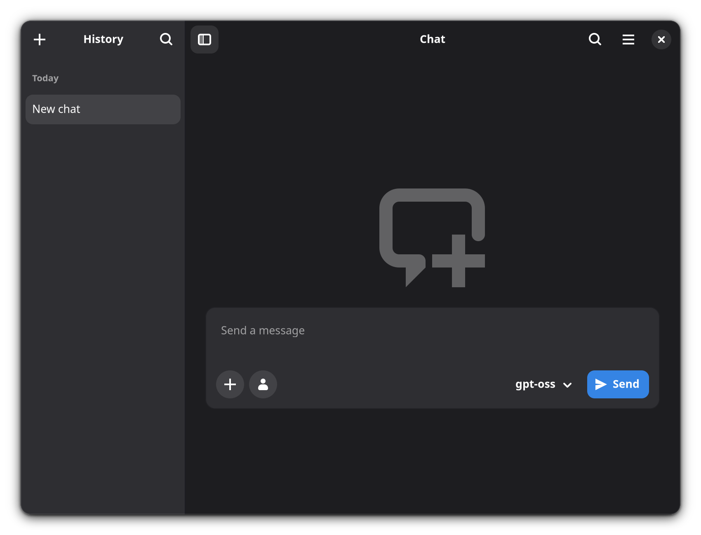
</picture>

[Dark](main.png) · [Light](light/main.png)

### Code blocks & message details
Syntax-highlighted code blocks with one-click copy, alongside the hover `ⓘ` details popover showing the model, generation speed, token counts, and timing.

<picture>
  <source media="(prefers-color-scheme: dark)" srcset="code.png">
  <source media="(prefers-color-scheme: light)" srcset="light/code.png">
  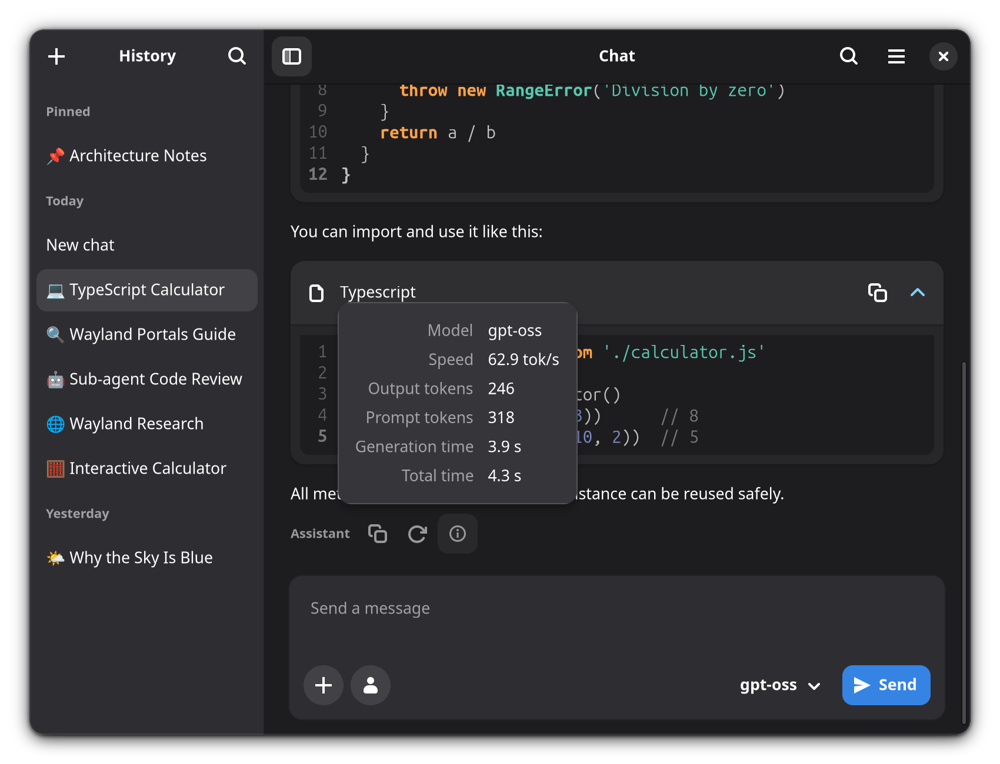
</picture>

[Dark](code.png) · [Light](light/code.png)

### Find in conversation
Press `Ctrl+Shift+F` to search within a long conversation, highlight every match across prose and code blocks, and step through occurrences with a live counter.

<picture>
  <source media="(prefers-color-scheme: dark)" srcset="find.png">
  <source media="(prefers-color-scheme: light)" srcset="light/find.png">
  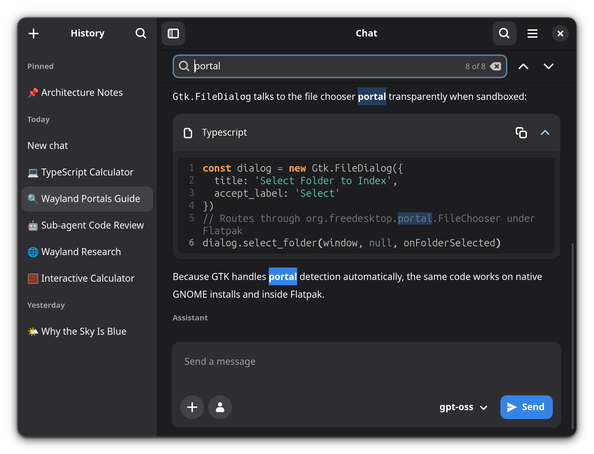
</picture>

[Dark](find.png) · [Light](light/find.png)

### Semantic conversation search
Search across past conversations by meaning as well as keywords directly from the sidebar.

<picture>
  <source media="(prefers-color-scheme: dark)" srcset="search.png">
  <source media="(prefers-color-scheme: light)" srcset="light/search.png">
  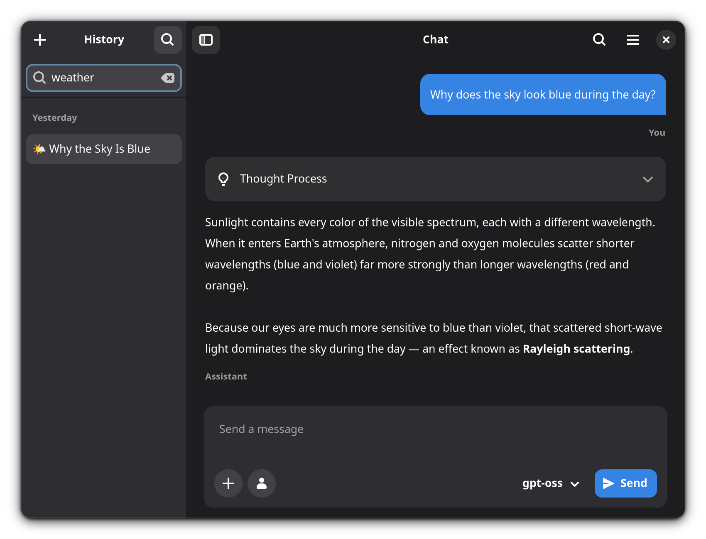
</picture>

[Dark](search.png) · [Light](light/search.png)

### Slash commands
Type `/` to filter and run inline commands such as `/deepsearch`, `/mcp`, `/skills`, `/export`, `/import`, `/hn`, or `/compress` with keyboard navigation.

<picture>
  <source media="(prefers-color-scheme: dark)" srcset="commands.png">
  <source media="(prefers-color-scheme: light)" srcset="light/commands.png">
  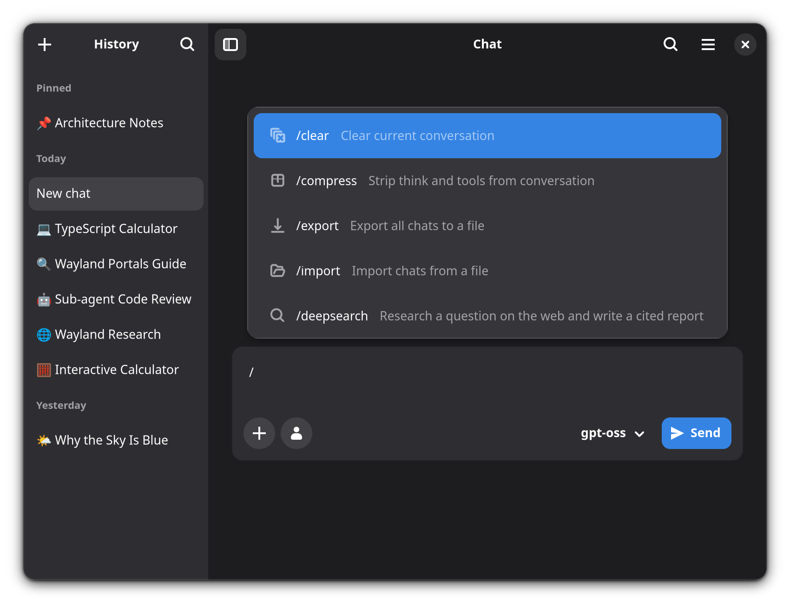
</picture>

[Dark](commands.png) · [Light](light/commands.png)

---

## Research, Skills & Sub-agents

### Deep Search
`/deepsearch` plans web queries, reads relevant pages, and writes a cited report with numbered `[n]` references linked to clickable source buttons.

<picture>
  <source media="(prefers-color-scheme: dark)" srcset="deepsearch.png">
  <source media="(prefers-color-scheme: light)" srcset="light/deepsearch.png">
  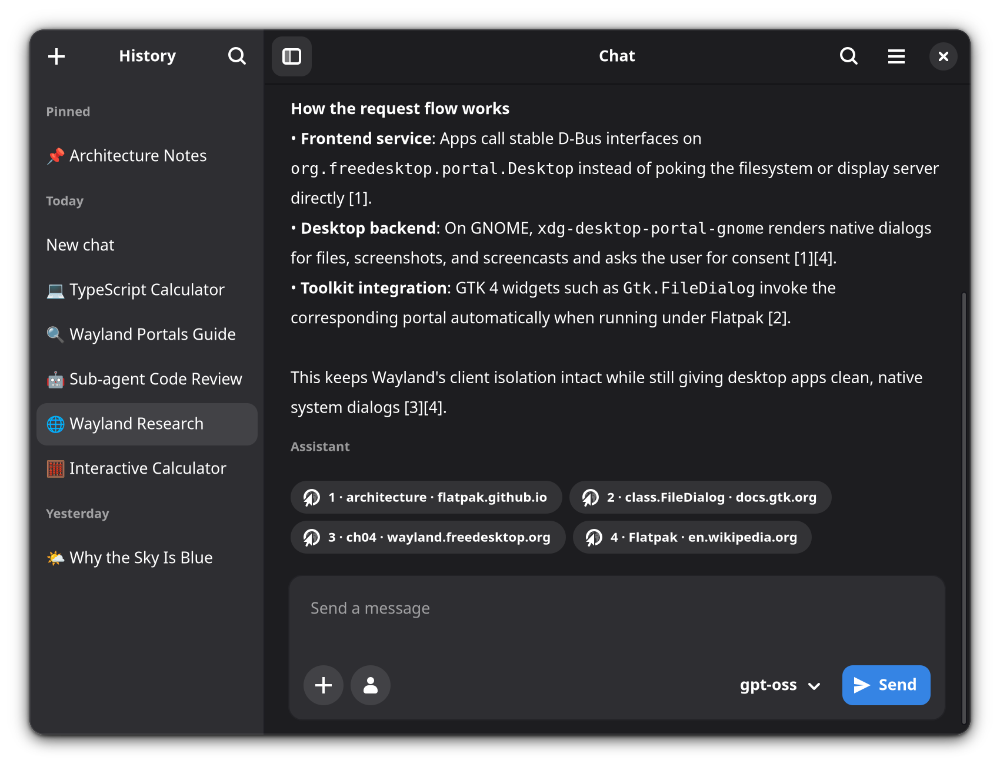
</picture>

[Dark](deepsearch.png) · [Light](light/deepsearch.png)

### Sub-agents & live tool calls
The model can delegate subtasks to a skill in its own isolated context. Each tool call shows a readable action label, status icon, and duration.

<picture>
  <source media="(prefers-color-scheme: dark)" srcset="subagents.png">
  <source media="(prefers-color-scheme: light)" srcset="light/subagents.png">
  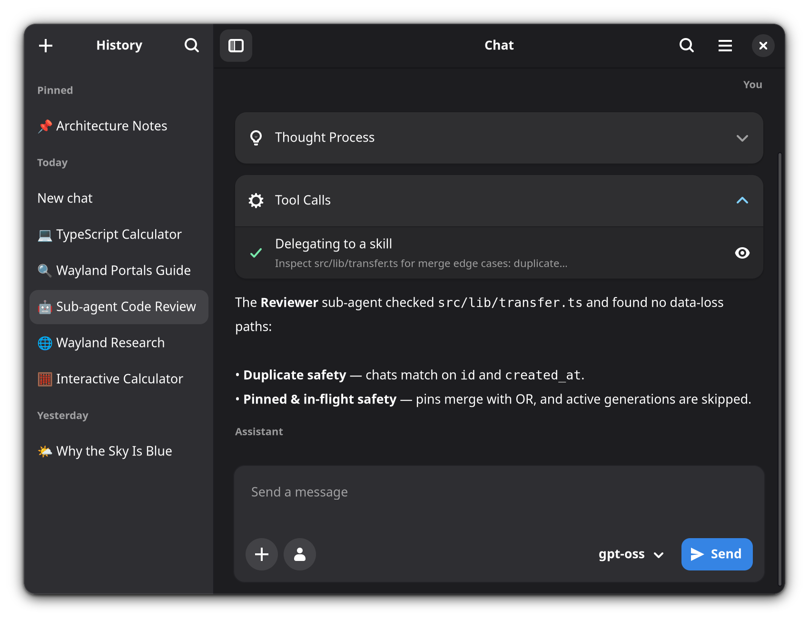
</picture>

[Dark](subagents.png) · [Light](light/subagents.png)

### Skills editor
Manage built-in and custom `@skills` in a dedicated window with a syntax-highlighted Markdown editor, an enable toggle, and optional per-skill tool overrides.

<picture>
  <source media="(prefers-color-scheme: dark)" srcset="skills.png">
  <source media="(prefers-color-scheme: light)" srcset="light/skills.png">
  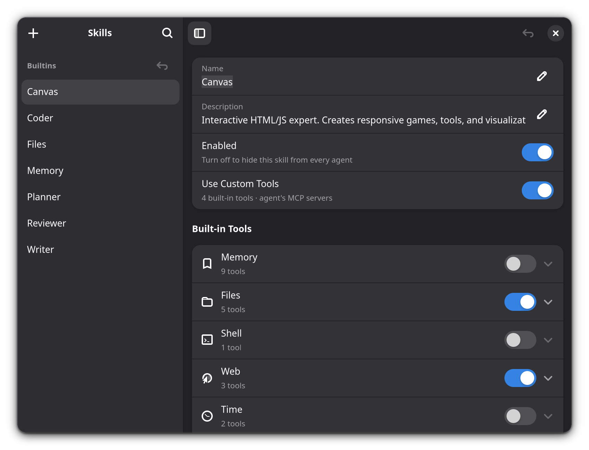
</picture>

[Dark](skills.png) · [Light](light/skills.png)

---

## Tools, MCP & Permissions

### Agent profiles & built-in tools
`Settings → Tools` lets you configure separate Main Agent and Sub-agents profiles, turning built-in tool groups, MCP servers, and skills on or off.

<picture>
  <source media="(prefers-color-scheme: dark)" srcset="tools.png">
  <source media="(prefers-color-scheme: light)" srcset="light/tools.png">
  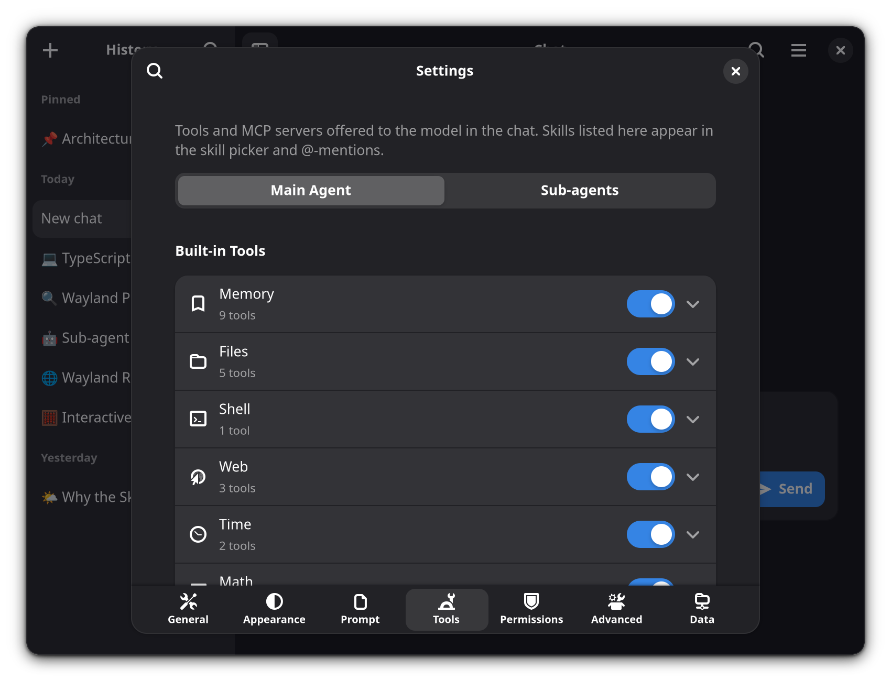
</picture>

[Dark](tools.png) · [Light](light/tools.png)

### MCP servers
Connect external Model Context Protocol servers over stdio or Streamable HTTP, inspect connection status, and enable or disable individual tools per server.

<picture>
  <source media="(prefers-color-scheme: dark)" srcset="mcp.png">
  <source media="(prefers-color-scheme: light)" srcset="light/mcp.png">
  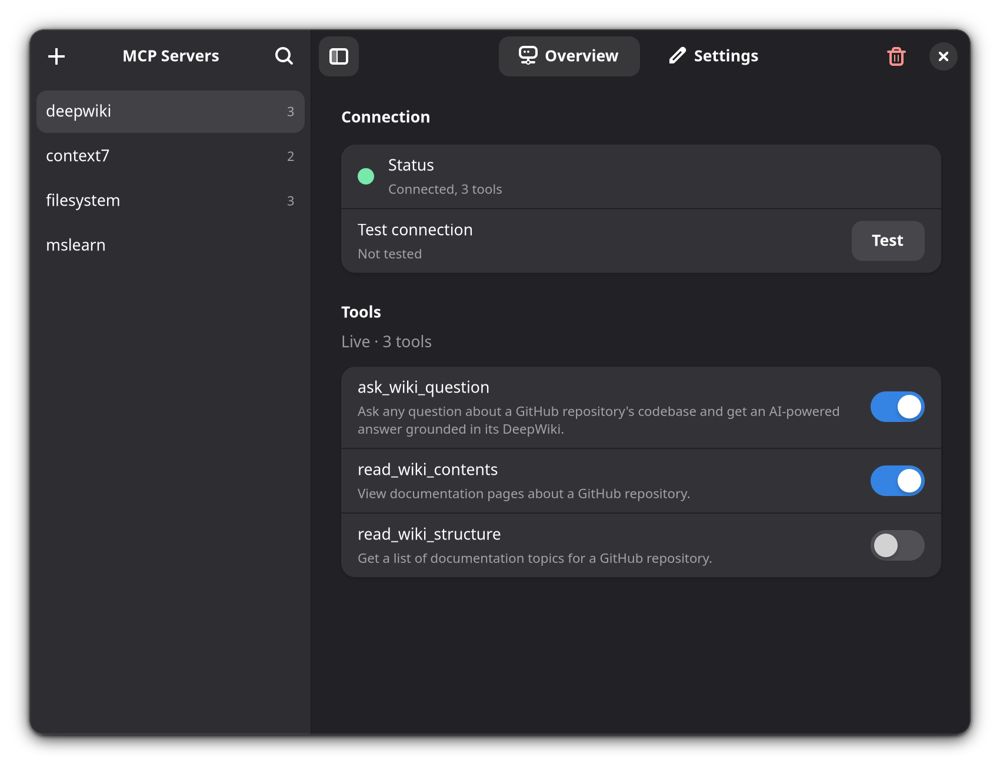
</picture>

[Dark](mcp.png) · [Light](light/mcp.png)

### MCP server catalog
Add public, API-key-free MCP servers (such as DeepWiki, Context7, Git, or Filesystem) pre-filled and ready to review before enabling.

<picture>
  <source media="(prefers-color-scheme: dark)" srcset="mcp-catalog.png">
  <source media="(prefers-color-scheme: light)" srcset="light/mcp-catalog.png">
  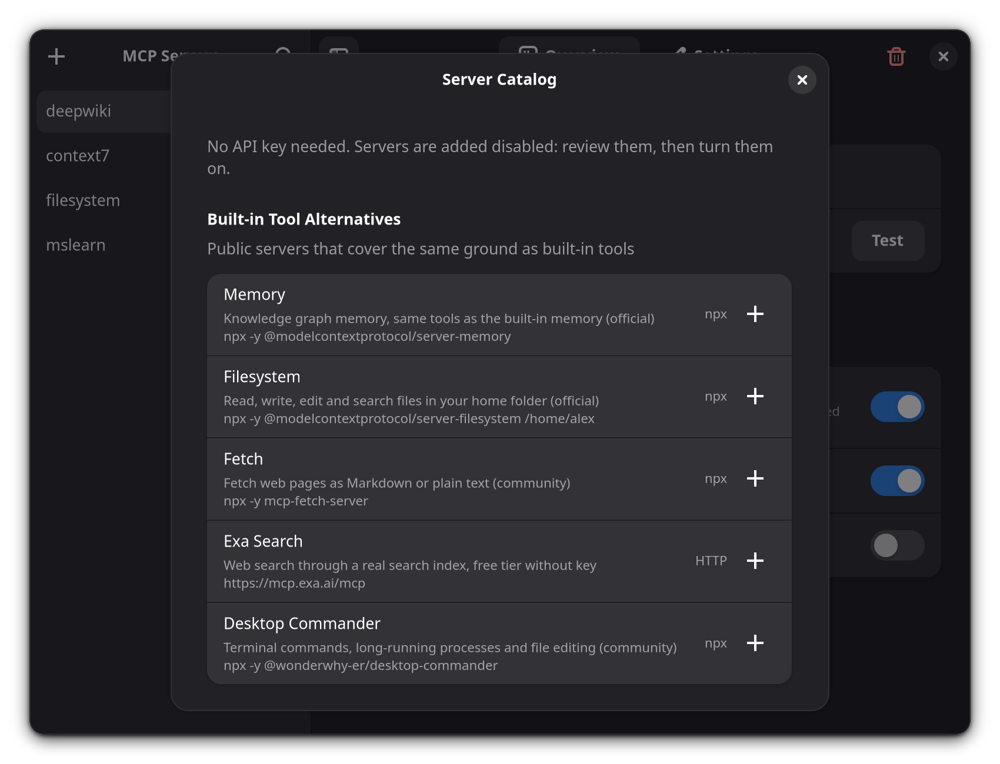
</picture>

[Dark](mcp-catalog.png) · [Light](light/mcp-catalog.png)

### Tool permissions
Control how sensitive actions behave with Ask, Auto-accept, or Deny rules across Terminal Commands, File Edits, File Reads, Applications, and MCP Servers.

<picture>
  <source media="(prefers-color-scheme: dark)" srcset="permissions.png">
  <source media="(prefers-color-scheme: light)" srcset="light/permissions.png">
  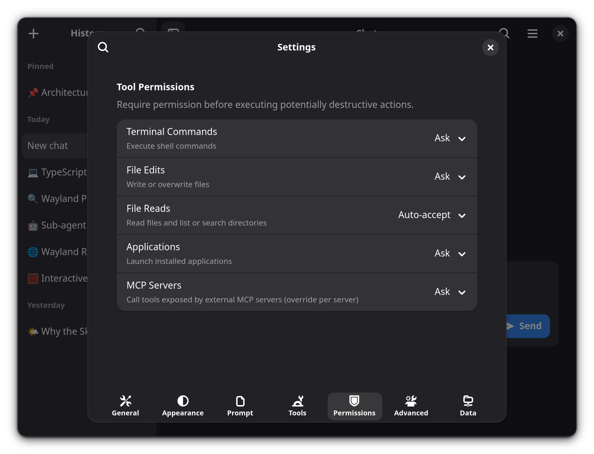
</picture>

[Dark](permissions.png) · [Light](light/permissions.png)

---

## Canvas, Local Files & Data

### Interactive HTML Canvas (chat view)
Using `@Canvas` and `render_html`, the model builds a self-contained web app and exposes an inline "Open Preview" button inside the tool call row.

<picture>
  <source media="(prefers-color-scheme: dark)" srcset="canvas-1.png">
  <source media="(prefers-color-scheme: light)" srcset="light/canvas-1.png">
  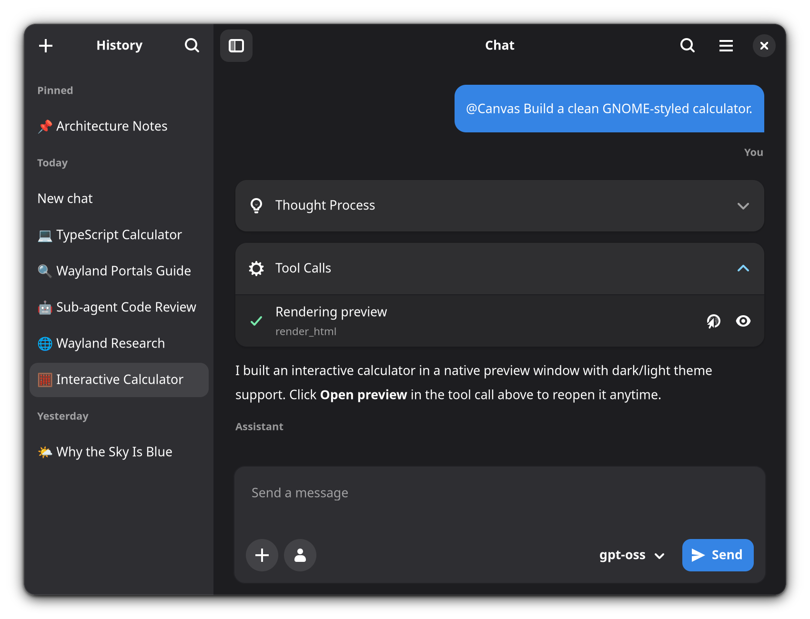
</picture>

[Dark](canvas-1.png) · [Light](light/canvas-1.png)

### Interactive HTML Canvas (preview window)
Generated HTML, CSS, and JavaScript render natively inside an isolated WebKitGTK preview window.

<picture>
  <source media="(prefers-color-scheme: dark)" srcset="canvas-2.png">
  <source media="(prefers-color-scheme: light)" srcset="light/canvas-2.png">
  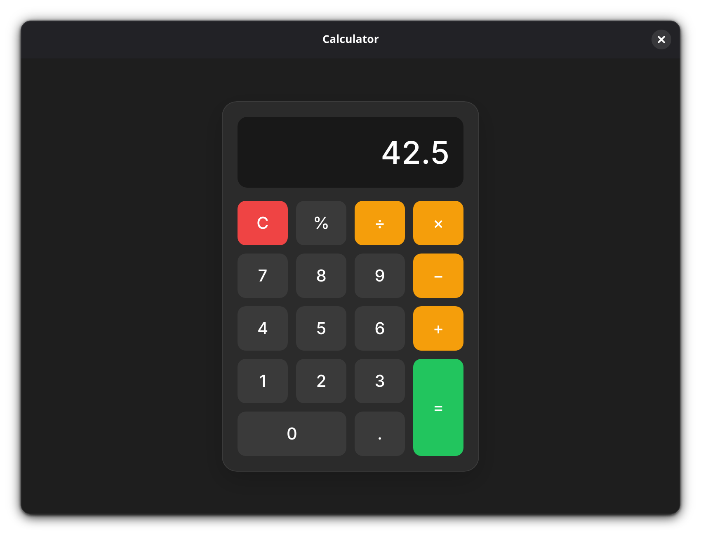
</picture>

[Dark](canvas-2.png) · [Light](light/canvas-2.png)

### Indexed folders (Local RAG)
Index local project folders into the private SQLite vector store to search and ground answers in your own files.

<picture>
  <source media="(prefers-color-scheme: dark)" srcset="rag.png">
  <source media="(prefers-color-scheme: light)" srcset="light/rag.png">
  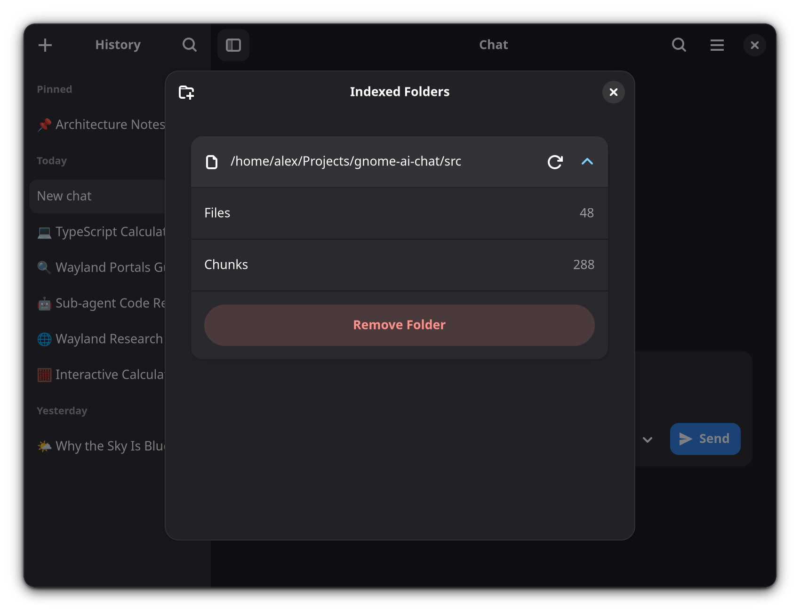
</picture>

[Dark](rag.png) · [Light](light/rag.png)

### Data management & import/export
`Settings → Data` provides duplicate-free JSON backup and restore for all conversations, along with search index maintenance.

<picture>
  <source media="(prefers-color-scheme: dark)" srcset="data.png">
  <source media="(prefers-color-scheme: light)" srcset="light/data.png">
  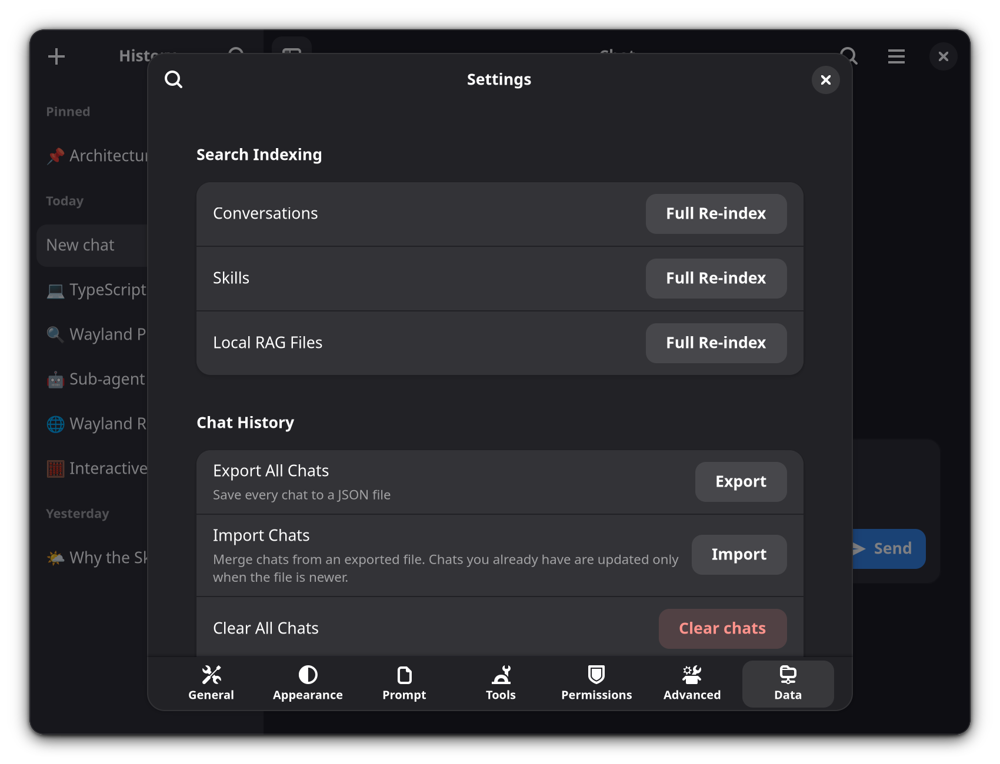
</picture>

[Dark](data.png) · [Light](light/data.png)

### Performance stats
Inspect session uptime, active agent time, and per-model request and token usage.

<picture>
  <source media="(prefers-color-scheme: dark)" srcset="stats.png">
  <source media="(prefers-color-scheme: light)" srcset="light/stats.png">
  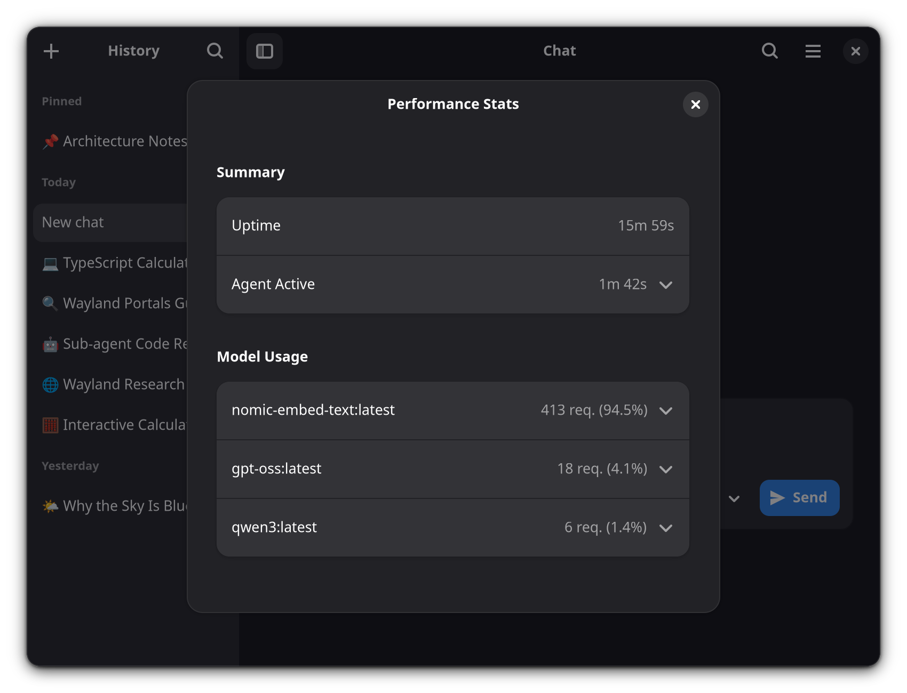
</picture>

[Dark](stats.png) · [Light](light/stats.png)
